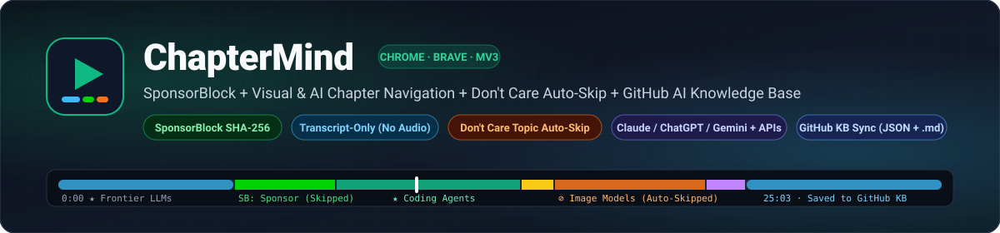
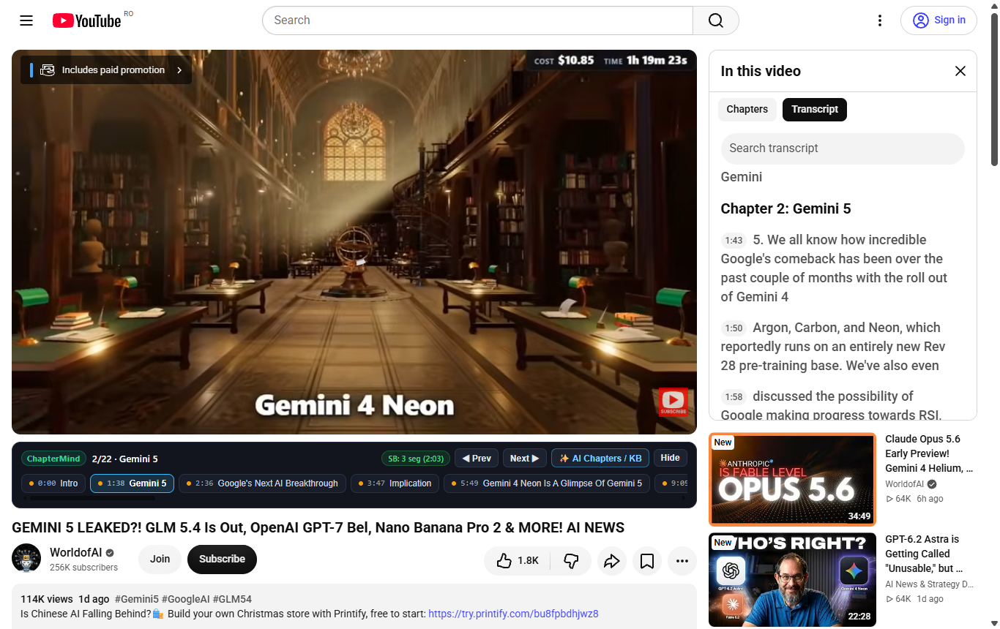
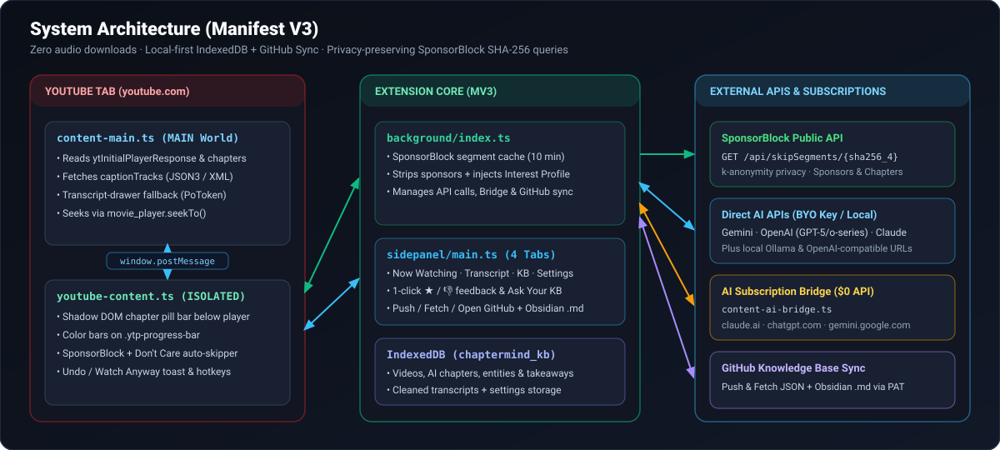
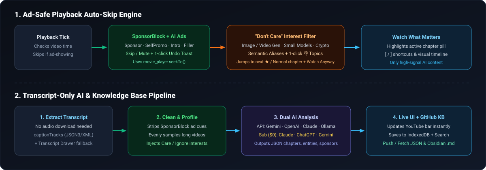

<div align="center">



<br />

[](manifest.json)
[](tsconfig.json)
[](src/shared/sponsorblock.ts)
[](tests)
[](LICENSE)

[Screenshots](#-live-screenshots) • [Architecture](#-system-architecture) • [Auto-Skip Pipeline](#-smart-auto-skip-and-ai-pipeline) • [AI APIs vs Subscriptions](#-dual-ai-engine-apis--your-subscriptions) • [GitHub KB Sync](#-github-knowledge-base-sync) • [Install](#-installation-chrome--brave--edge)

</div>

---

ChapterMind is built for people who watch **high-density AI & tech videos** on YouTube and want to:
1. **Never sit through sponsor reads or filler** — SponsorBlock skips/mutes ads *and* strips sponsor cues from the transcript before AI ever reads it.
2. **Jump straight to the exact chapter** — clickable chapter pills right under the player, timeline bars, keyboard shortcuts, and AI-split topic chapters when creators don't add them.
3. **Auto-skip topics you don't care about** — tell ChapterMind once (`image models`, `video generation`, `useless small models`, `crypto`, or click **`👎`** on any chapter) and it skips those chapters automatically with a **`Watch Anyway`** undo toast.
4. **Build a personal, searchable AI Knowledge Base** — transcript-only (zero audio processing), works with **direct AI APIs** *or* your existing **Claude / ChatGPT / Gemini subscriptions**, and syncs JSON + Obsidian-ready Markdown straight to your own **GitHub repository**.

---

## 📸 Live Screenshots

<table>
  <tr>
    <td width="60%" valign="top">
      <a href="docs/youtube-player-preview.png">
        
      </a>
      <br />
      <sub><b>In-Page YouTube Chapter Strip &amp; Timeline Overlay</b> — Mounted below the player in Shadow DOM with SponsorBlock bars, active chapter tracking, Prev/Next skip, and 1-click Side Panel access.</sub>
    </td>
    <td width="40%" valign="top">
      <a href="docs/sidepanel-preview.png">
        
      </a>
      <br />
      <sub><b>Side Panel</b> — Color-coded timeline scrubber, live <b>Don't Care / Auto-Skip</b> filter chips, ★ prioritized chapters, ⊘ auto-skipped chapters, and 1-click ★ / 👎 training.</sub>
    </td>
  </tr>
</table>

---

## 🏗 System Architecture



---

## 🎯 Smart Auto-Skip & AI Pipeline



### How "Don't Care" Filtering Works
- **Semantic Alias Engine ([interests.ts](src/shared/interests.ts))**: Ignoring `"image models"` automatically catches `Midjourney`, `Flux`, `DALL-E`, `Stable Diffusion`, `Imagen`, and `Nano Banana`; ignoring `"video generation"` catches `Sora`, `Veo`, `Runway`, `Kling`, and `Luma`; ignoring `"useless small models"` catches `1B–3B / tiny / edge` models — plus exact matching for any custom keyword or topic you add.
- **1-Click Feedback**: Click **`👎`** on any chapter card to immediately add that topic to your ignore list (or **`★`** to boost topics you care about).
- **Prompt-Aware**: Both API and Subscription prompts inject your **Viewer Interest Profile**, so the AI tags chapters `must_watch`, `normal`, or `skip` before you even press play.

---

## 🤖 Dual AI Engine (APIs **or** Your Subscriptions)

| Capability | Direct API Mode | AI Subscription Bridge Mode |
| :--- | :--- | :--- |
| **Supported Providers** | Google Gemini, OpenAI (`gpt-4.1`, `gpt-5*`, `o1`–`o9`), Anthropic Claude, Custom / Ollama | **Claude Pro/Max** (`claude.ai`), **ChatGPT Plus/Pro** (`chatgpt.com`), **Gemini Advanced** (`gemini.google.com`) |
| **Extra Cost** | Pay-as-you-go API key (or free Gemini / local Ollama) | **\$0 extra** — uses your existing web subscription |
| **Workflow** | 1 click (`✨ Analyze via API`) | 2 clicks via floating **Bridge Pill** (`1. Paste Prompt` → Enter → `2. Capture Reply`) |
| **Transcript Cleaning** | Strips SponsorBlock cues before sending | Strips SponsorBlock cues before sending |
| **Ask Your Knowledge Base** | Instant grounded answer with `[Title @ MM:SS]` citations | Grounded context sent to your AI chat tab & captured back |

---

## 🐙 GitHub Knowledge Base Sync

Store your entire AI video library in your own private or public GitHub repository so you own your notes in plain JSON & Markdown and can sync across Brave, Chrome, and Edge:

```text
<your-repo>/
└── knowledge-base/
    ├── index.json                           # Video manifest + Care / Don't Care interest profile
    ├── videos/
    │   └── 7n3cZzR0tVE.json                 # Full lossless KnowledgeEntry (for cross-browser Fetch)
    └── notes/
        └── 7n3cZzR0tVE-gemini-5-leaked.md   # Obsidian-ready Markdown with clickable timestamps
```

<details>
<summary><b>Example Generated Obsidian Markdown Note (Click to expand)</b></summary>

```markdown
---
video_id: "7n3cZzR0tVE"
title: "GEMINI 5 LEAKED?! GLM 5.4 Is Out, OpenAI GPT-7 Bel, Nano Banana Pro 2 & MORE! AI NEWS"
channel: "WorldofAI"
url: "https://youtu.be/7n3cZzR0tVE"
duration: "25:03"
sponsor_stripped_sec: 123
saved_date: "2026-11-24"
ai_provider: "openai:gpt-5-mini"
tags:
  - ai-news
  - frontier-llms
---

# GEMINI 5 LEAKED?! GLM 5.4 Is Out...

> **Channel:** WorldofAI | **Watch:** https://youtu.be/7n3cZzR0tVE | **SponsorBlock Stripped:** 123s

## TL;DR
Covers Gemini 5 rumors following Gemini 4 Neon, Z.ai's GLM 5.4 coding release, and OpenAI pre-training scaling data.

## Chapters
- [1:38](https://youtu.be/7n3cZzR0tVE?t=98) **Gemini 5 Teased by DeepMind Researchers** — Early hints about the next frontier pre-training base.
- [5:50](https://youtu.be/7n3cZzR0tVE?t=350) **GLM 5.4 Release** — Open-weight coding & vision benchmarks.
```

</details>

### Connect GitHub Sync in 3 Steps
1. Create a GitHub repo for your notes (e.g. `your-username/chaptermind-kb`, private or public).
2. Generate a [Fine-grained Personal Access Token](https://github.com/settings/personal-access-tokens/new) scoped to that single repo with **Contents: Read and write**.
3. Open **ChapterMind → Settings → GitHub Knowledge Base Sync**, enter `owner/repo` + your token, click **Test Git** (automatically saves on success), then use **`↑ Push Git`**, **`↓ Fetch Git`**, and **`Open Git ↗`** in the **Knowledge Base** tab.

---

## 📦 Installation (Chrome / Brave / Edge)

1. **Clone & build `dist/`**:
   ```bash
   git clone https://github.com/liviuxyz-ctrl/chaptermind.git
   cd chaptermind
   npm install
   npm run build
   ```
2. Open **`chrome://extensions`** (or **`brave://extensions`** / **`edge://extensions`**).
3. Enable **Developer mode** (top-right).
4. Click **Load unpacked** and choose the generated **`dist/`** folder.
5. Open any YouTube video and click the **ChapterMind** toolbar icon to open the Side Panel.

---

## ⌨️ Keyboard Shortcuts (on YouTube)

| Shortcut | Action |
| :---: | :--- |
| `[` | Previous chapter *(restarts current chapter if > 3s in)* |
| `]` | Next chapter |
| `Alt + S` | Skip current SponsorBlock segment / jump to Highlight |
| `Alt + C` | Collapse or expand the in-page chapter strip |

---

## 🧪 Development & Verification

```bash
npm run typecheck   # Strict TypeScript check (tsc --noEmit)
npm run test        # Vitest unit test suite (25 tests across 7 files)
npm run build       # esbuild bundler + PNG icon generator + manifest check
npm run check       # Runs typecheck + unit tests + build
npm run test:e2e    # Playwright Chromium live YouTube + Side Panel E2E suite
```

### Project Layout
```text
chaptermind/
├── manifest.json                 # Chrome Extension Manifest V3 definition
├── docs/                         # Vector SVG diagrams & live screenshots
├── scripts/
│   ├── build.mjs                 # Bundles 5 entrypoints + generates icons into dist/
│   └── e2e-test.mjs              # Live Chromium E2E test against YouTube & Side Panel
├── src/
│   ├── background/index.ts       # Service worker: SponsorBlock cache, AI calls, Bridge, GitHub sync
│   ├── content/
│   │   ├── main-world.ts         # MAIN-world extractor (captionTracks + 2026 transcript drawer fallback)
│   │   ├── youtube-content.ts    # Shadow DOM chapter strip, timeline bars, auto-skipper & Undo toast
│   │   └── ai-bridge.ts          # Floating Bridge Pill on claude.ai, chatgpt.com, gemini.google.com
│   ├── shared/
│   │   ├── sponsorblock.ts       # SHA-256 prefix API client & transcript ad stripper
│   │   ├── transcript.ts         # JSON3 / XML parsers, cue merger & smart downsampler
│   │   ├── chapters.ts           # Description parser, source merger & adjacent chapter logic
│   │   ├── interests.ts          # Semantic "Don't Care" / "Care" matcher & topic extractor
│   │   ├── prompts.ts            # Interest-aware analysis & KB Q&A prompts + JSON recovery parser
│   │   ├── ai-client.ts          # Gemini, OpenAI (incl. GPT-5/o-series), Anthropic & Ollama client
│   │   ├── kb-storage.ts         # IndexedDB storage, ranked search & Markdown/Obsidian exporter
│   │   ├── github-sync.ts        # GitHub Contents API push/fetch sync & token validator
│   │   └── types.ts              # Shared TypeScript interfaces & defaults
│   └── sidepanel/                # 4-tab Side Panel UI (Now Watching, Transcript, KB, Settings)
└── tests/                        # Vitest unit tests
```

---

## 🔒 Privacy & Credits
- **SponsorBlock Privacy**: Uses SHA-256 4-char prefixes (`usePrivacyPrefix`) by default so the SponsorBlock server never sees the exact video ID you're watching. Powered by [ajayyy/SponsorBlock](https://github.com/ajayyy/SponsorBlock).
- **Local-First Secrets**: API keys, GitHub tokens, and your Knowledge Base stay in your browser (`chrome.storage.local` / `IndexedDB`) and are only sent to the API or GitHub repo you explicitly configure.
- **License**: [MIT](LICENSE)
