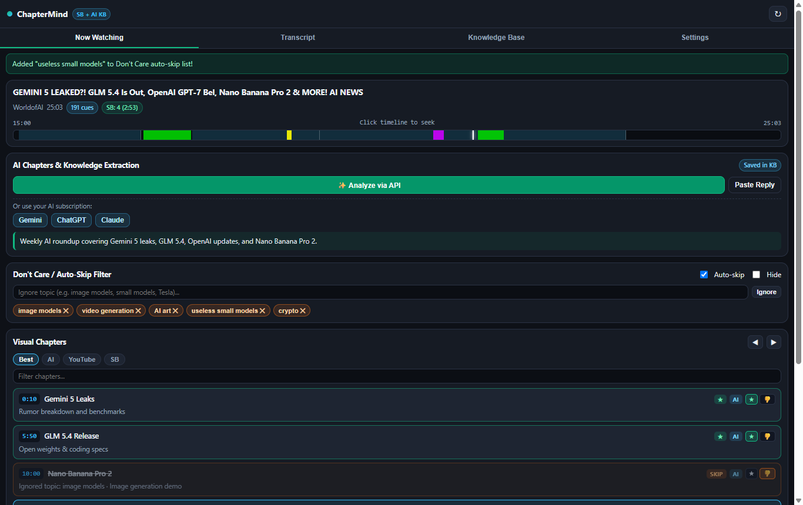

# ChapterMind — YouTube SponsorBlock, AI Chapters & Knowledge Base

A Chrome / Brave / Edge (Manifest V3) extension built for people who watch lots of AI & tech videos on YouTube:

- **Auto-skips sponsors & filler** via [SponsorBlock](https://github.com/ajayyy/SponsorBlock) (and strips sponsor reads *before* AI ever sees the transcript)
- **Visual chapter navigation** right under the YouTube player, on the progress bar, and in the Side Panel
- **"Don't Care" Smart Chapter Auto-Skip** — automatically skips topics you don't care about (e.g. image models, video generators, small models, crypto) with 1-click `👎` / `★` training
- **Transcript-only (no audio processing)** — fast, lightweight extraction directly from YouTube captions & transcript drawer
- **Works with BOTH AI APIs & AI Subscriptions** — bring your own API key (**Gemini**, **OpenAI** incl. GPT-5/o-series, **Anthropic**, **Ollama**), or use your existing **Claude / ChatGPT / Gemini** web subscription at \$0 extra API cost
- **Personal AI Video Knowledge Base + GitHub Sync** — searchable local IndexedDB library with timestamp jump links, Obsidian Markdown export, and **Push / Fetch sync to your own GitHub repo**



---

## Features

### 1. Built-in SponsorBlock + Transcript Cleaning
- Queries `sponsor.ajay.app` using SHA-256 4-character prefixes (k-anonymity privacy).
- Configurable per-category rules (`Skip`, `Mute`, `Show`, `Ignore`) for `sponsor`, `selfpromo`, `interaction`, `intro`, `outro`, `filler`, `poi_highlight`, and SponsorBlock `chapter` segments.
- Shows an in-player **Skip Toast + Undo** button and color-coded segments on YouTube's `.ytp-progress-bar`.
- Removes sponsor/ad cues from the transcript before sending it to AI, and optionally detects sponsor reads on brand-new videos not yet in SponsorBlock.

### 2. Visual Chapters & "Don't Care" Auto-Skip
- Injects a collapsible **In-Page Chapter Strip** directly below the YouTube player and a full chapter navigator inside the **Side Panel**.
- **Personal Interest Filter**: Preconfigured + customizable ignore topics (`image models`, `video generation`, `AI art`, `useless small models`, `crypto`, or anything you type) with semantic alias matching (e.g. `Midjourney`, `Flux`, `Nano Banana`, `Sora`, `Veo`).
- Click **`👎`** on any chapter to ignore that topic going forward, or **`★`** to prioritize topics you care about. Playback automatically skips ignored chapters and shows a **`Skipped "..." · Watch Anyway`** toast.

### 3. Dual AI Workflow (API Keys **or** Your Subscriptions)
- **Direct API Mode**: Supports **Google Gemini**, **OpenAI** (including `gpt-5*` / `o1`–`o9` default-temperature handling), **Anthropic Claude**, and **Custom / Ollama** (`http://localhost:11434/v1`).
- **AI Subscription Bridge (\$0 extra cost)**: Click **Claude**, **ChatGPT**, or **Gemini** in the Side Panel to open your signed-in web AI tab with a floating **ChapterMind AI Bridge** pill (`1. Paste Prompt` → `2. Capture Reply`) that imports chapters, TL;DRs, takeaways, and entities straight back into YouTube & your Knowledge Base.

### 4. Local Knowledge Base & GitHub Cloud Sync
- Stores TL;DRs, chapters, key takeaways, tagged entities (`model`, `tool`, `repo`, `paper`, `company`, `concept`), `#tags`, and cleaned transcripts locally in IndexedDB.
- **Ask Your Knowledge Base** across all saved videos using either an API key or your Claude / ChatGPT / Gemini subscription.
- **GitHub KB Sync (`↑ Push Git` / `↓ Fetch Git`)**:
  - Back up and sync your Knowledge Base (`videos/{videoId}.json`, Obsidian-ready `notes/*.md`, and `index.json` with your interest profile) to any private or public GitHub repository.
  - Fetch your Knowledge Base on any other browser or machine.

---

## Installation (Chrome / Brave / Edge)

1. Clone this repo and build `dist/`:
   ```bash
   git clone https://github.com/liviuxyz-ctrl/chaptermind.git
   cd chaptermind
   npm install
   npm run build
   ```
2. Open **`chrome://extensions`** (or **`brave://extensions`** / **`edge://extensions`**).
3. Enable **Developer mode** (top-right).
4. Click **Load unpacked** and select the generated **`dist/`** folder.
5. Open any YouTube video and click the **ChapterMind** icon in your browser toolbar to open the Side Panel.

---

## Connecting GitHub Knowledge Base Sync (Optional)

1. Create a GitHub repo for your notes (e.g. `your-username/chaptermind-kb`, private or public).
2. Create a GitHub **Fine-grained Personal Access Token** (`Settings → Developer settings → Personal access tokens → Fine-grained tokens`) scoped to that repo with **Contents: Read and write**.
3. Open **ChapterMind → Settings → GitHub Knowledge Base Sync**, enter `your-username/chaptermind-kb` + your token, and click **Test Git** → **Save Git Sync**.
4. Use **`↑ Push Git`** and **`↓ Fetch Git`** in the **Knowledge Base** tab anytime (or enable **Auto-push newly analyzed videos**).

---

## Keyboard Shortcuts (on YouTube)

| Shortcut | Action |
| --- | --- |
| `[` | Previous chapter (restarts current chapter if >3s in) |
| `]` | Next chapter |
| `Alt + S` | Skip current sponsor segment / jump to Highlight |
| `Alt + C` | Toggle in-page chapter strip |

---

## Development & Tests

```bash
npm run typecheck   # Strict TypeScript check
npm run test        # Vitest unit tests
npm run build       # Bundle MV3 extension + generate PNG icons into dist/
npm run check       # Run typecheck + unit tests + build
npm run test:e2e    # Playwright Chromium live YouTube E2E test
```

### Project Structure
```text
src/
  background/     MV3 service worker (SponsorBlock cache, AI calls, GitHub sync, KB)
  content/        MAIN-world YouTube extractor, YouTube HUD/skipper, AI web bridge
  shared/         SponsorBlock, transcript, chapters, interests, prompts, AI & GitHub clients, KB IndexedDB
  sidepanel/      4-tab Side Panel UI (Now Watching, Transcript, Knowledge Base, Settings)
scripts/
  build.mjs       esbuild bundler + PNG icon generator + manifest verification
  e2e-test.mjs    Playwright live YouTube + Side Panel E2E suite
tests/            Vitest unit tests
```

## Privacy & Credits
- SponsorBlock queries use SHA-256 4-char prefixes (`usePrivacyPrefix`) by default, powered by [ajayyy/SponsorBlock](https://github.com/ajayyy/SponsorBlock).
- API keys, GitHub tokens, and Knowledge Base data stay in your local browser storage (`chrome.storage.local` / `IndexedDB`) and are only sent to the endpoints you explicitly configure.
- Licensed under the [MIT License](LICENSE).
